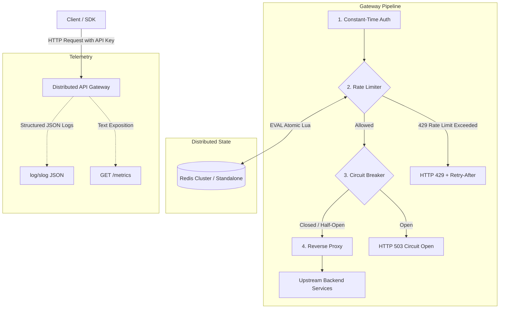

# Distributed Rate-Limiter & API Gateway (v2.0)

[](https://github.com/Chiru9030/distributed-rate-limiter-gateway/actions/workflows/ci.yml)
[](cmd/gateway/main.go)
[](https://golang.org/)
[](sdk-ts/package.json)
[](https://opensource.org/licenses/MIT)

A high-performance, distributed **API Gateway** written in **Go 1.24** with multi-upstream load balancing, active health checking, atomic Redis Lua rate limiting (Token Bucket, Sliding Window, Leaky Bucket), constant-time API key auth, dynamic tenant hot-reloading, circuit breaking, Prometheus telemetry, and an official typed **TypeScript Client SDK v2**.

---

## What's New in v2.0
- **Multi-Upstream Load Balancing (`LoadBalancer`)**: Round-Robin and Weighted balancing across multiple backend instance pools with degraded single-node fallback.
- **Active Background Health Checking**: Continuous background health monitor probing `/health` on all registered nodes, seamlessly isolating degraded nodes.
- **Leaky Bucket Traffic Shaping (`AlgoLeakyBucket`)**: Constant leak-rate smoothing algorithm alongside Token Bucket and Sliding Window Log.
- **Dynamic Hot-Reloading Admin API**: `POST /v1/admin/tenants` allows provisioning new API keys and updating rate limits in real-time with zero downtime or gateway restarts.
- **TypeScript Client SDK v2.0 (`@chiru9030/gateway-sdk`)**: Added bounded-concurrency `client.batch(...)` executor and full support for v2 features.

---

## Table of Contents
- [Architecture Overview](#architecture-overview)
- [Rate Limiting Algorithms](#rate-limiting-algorithms)
  - [1. Distributed Token Bucket (Redis Lua)](#1-distributed-token-bucket-redis-lua)
  - [2. Sliding Window Log (Redis Sorted Sets)](#2-sliding-window-log-redis-sorted-sets)
  - [3. Leaky Bucket Traffic Shaping](#3-leaky-bucket-traffic-shaping)
  - [4. Standard Rate-Limit HTTP Headers](#4-standard-rate-limit-http-headers)
- [Multi-Upstream Load Balancing & Health Checking](#multi-upstream-load-balancing--health-checking)
- [Dynamic Hot-Reloading Admin Endpoint](#dynamic-hot-reloading-admin-endpoint)
- [Enterprise Resilience & Security](#enterprise-resilience--security)
  - [Circuit Breaker Pattern](#circuit-breaker-pattern)
  - [Constant-Time API Key Authentication](#constant-time-api-key-authentication)
  - [Standardized Stripe-Style Error Envelopes](#standardized-stripe-style-error-envelopes)
- [Observability & Telemetry](#observability--telemetry)
- [TypeScript Client SDK (`@chiru9030/gateway-sdk`)](#typescript-client-sdk-chiru9030gateway-sdk)
- [Getting Started & Local Setup](#getting-started--local-setup)
- [Test Suite & Benchmarks](#test-suite--benchmarks)

---

## Architecture Overview



---

## Rate Limiting Algorithms

### 1. Distributed Token Bucket (Redis Lua)
Implemented in [`internal/ratelimit/redis.go`](./internal/ratelimit/redis.go) using an atomic Lua script:
- Stores `tokens` (floating-point capacity) and `last_refreshed_ts` (epoch milliseconds) in a Redis Hash (`HMGET`/`HSET`).
- Lazily computes fractional refills on each request based on elapsed time:
  $$\Delta \text{tokens} = \min(\text{capacity}, \text{current} + \Delta t \times \text{refill\_rate})$$
- Decrements 1.0 token if available and sets a sliding TTL (`PEXPIRE`), avoiding key accumulation.
- Executes in a single atomic Redis round-trip ($O(1)$ time complexity), completely immune to read-modify-write race conditions across horizontally scaled gateway replicas.

### 2. Sliding Window Log (Redis Sorted Sets)
Provides mathematically exact rate limiting without border-burst vulnerabilities:
- Stored as a Redis Sorted Set (`ZSET`) where score is request timestamp in milliseconds.
- Atomically clears expired entries: `ZREMRANGEBYSCORE key -inf (now - window)`.
- Checks `ZCARD key < limit`: if allowed, adds current request `ZADD key now unique_id` and sets TTL.
- If rejected, calculates the exact millisecond delay until the oldest item exits the window to populate `Retry-After`.

### 3. Standard Rate-Limit HTTP Headers
Every proxied and rate-limited response includes standardized IETF/Stripe headers:
```http
HTTP/1.1 429 Too Many Requests
X-RateLimit-Limit: 100
X-RateLimit-Remaining: 0
X-RateLimit-Reset: 1700000060
Retry-After: 5
X-Request-ID: req_a1b2c3d4e5f6
X-Trace-ID: tr_9876543210ab
Content-Type: application/json

{
  "error": {
    "type": "rate_limit_error",
    "code": "rate_limit_exceeded",
    "message": "Rate limit exceeded. Please retry after the duration indicated in Retry-After.",
    "request_id": "req_a1b2c3d4e5f6",
    "trace_id": "tr_9876543210ab"
  }
}
```

---

## Enterprise Resilience & Security

### Circuit Breaker Pattern
Implemented in [`internal/proxy/circuit_breaker.go`](./internal/proxy/circuit_breaker.go):
- **Closed**: Requests pass through to upstream. Consecutive 5xx/network errors increment the failure counter.
- **Open**: When failure threshold (default: 5) is reached, circuit opens immediately, shedding load and failing fast with `503 Service Unavailable` (`circuit_open`) to prevent upstream cascading brownouts.
- **Half-Open**: After reset timeout (default: 15s), a single probe request is permitted through. If successful, circuit recovers to `Closed`; if it fails, circuit returns to `Open`.

### Constant-Time API Key Authentication
API Keys (`X-API-Key` or `Authorization: Bearer <key>`) are validated using `crypto/subtle.ConstantTimeCompare`. This guarantees invariant execution time regardless of character match position, mitigating side-channel timing attacks.

### Standardized Stripe-Style Error Envelopes
All gateway-level errors (401, 404, 413, 429, 502, 503) emit consistent JSON structures containing:
- `type`: Machine-readable category (`authentication_error`, `rate_limit_error`, `invalid_request_error`, `api_connection_error`).
- `code`: Specific programmatic identifier (`invalid_api_key`, `circuit_open`, etc.).
- `request_id` & `trace_id`: Distributed tracing identifiers propagated upstream to backend microservices.

### Connection Pooling & Max Request Guard
- Redis client maintains a pre-warmed connection pool (`32` pooled TCP connections), avoiding per-request socket handshake overhead.
- Requests pass through `http.MaxBytesReader(w, r.Body, 2MB)` to protect against memory exhaustion or slowloris denial-of-service attempts.

---

## Observability & Telemetry

- **Prometheus Metrics (`/metrics`)**:
  - `gateway_requests_total`: Monotonic counter of all requests handled.
  - `gateway_rate_limited_total`: Counter of 429 rejections.
  - `gateway_auth_failures_total`: Counter of 401 rejections.
  - `gateway_upstream_errors_total`: Counter of upstream 5xx/timeouts.
  - `gateway_request_duration_microseconds_sum`: Cumulative latency for computing P50/P95/P99 percentiles.
- **Structured JSON Logging (`log/slog`)**:
  ```json
  {"time":"2026-11-12T12:00:00Z","level":"INFO","msg":"http_request","request_id":"req_123","trace_id":"tr_456","tenant":"acme_corp","method":"POST","path":"/v1/charges","status":200,"latency_ms":1.42}
  ```

---

## TypeScript Client SDK (`@chiru9030/gateway-sdk`)

A lightweight, zero-dependency client SDK located in [`sdk-ts/`](./sdk-ts/):

```typescript
import { GatewayClient, GatewayApiError } from '@chiru9030/gateway-sdk';

const client = new GatewayClient({
  baseUrl: 'https://api.yourgateway.com',
  apiKey: 'sk_test_acme_123',
  maxRetries: 3,
});

try {
  // Automatically attaches Idempotency-Key on mutating calls
  // Transparently retries with exponential backoff on 429 (respecting Retry-After)
  const response = await client.post<{ id: string }>('/v1/transfers', {
    amount: 5000,
  });

  console.log(`Success! Request ID: ${response.requestId}`);
  console.log(`Remaining quota: ${response.rateLimit.remaining}`);
} catch (err) {
  if (err instanceof GatewayApiError) {
    console.error(`API Error [${err.code}]: ${err.message} (status: ${err.status})`);
  }
}
```

---

## Getting Started & Local Setup

### Multi-Instance Cluster via Docker Compose
Launches 2 Gateway replicas behind Redis and an upstream echo service:

```bash
# Clone repository
git clone https://github.com/Chiru9030/distributed-rate-limiter-gateway.git
cd distributed-rate-limiter-gateway

# Start distributed cluster
docker compose up --build
```

Test requests against both gateway instances:
```bash
# Gateway 1 (Port 8080)
curl -i -H "Authorization: Bearer sk_test_acme_123" http://localhost:8080/v1/test

# Gateway 2 (Port 8081) - shares distributed Redis rate limit with Gateway 1
curl -i -H "Authorization: Bearer sk_test_acme_123" http://localhost:8081/v1/test

# Prometheus metrics
curl http://localhost:8080/metrics
```

---

## Test Suite & Benchmarks

Run Go unit tests and integration suites with the race detector enabled:
```bash
go test -v -race ./...
```
```
=== RUN   TestGatewayAuthRoutingRateLimitAndTelemetry
--- PASS: TestGatewayAuthRoutingRateLimitAndTelemetry (0.07s)
=== RUN   TestCircuitBreakerStateTransitions
--- PASS: TestCircuitBreakerStateTransitions (0.06s)
=== RUN   TestTokenBucketRefillAndBurst
--- PASS: TestTokenBucketRefillAndBurst (0.00s)
=== RUN   TestSlidingWindowLogPrecision
--- PASS: TestSlidingWindowLogPrecision (0.00s)
=== RUN   TestConcurrentGoroutineRateLimitSafety
--- PASS: TestConcurrentGoroutineRateLimitSafety (0.00s)
PASS
```

Build and test the TypeScript SDK:
```bash
cd sdk-ts
npm install
npm run build
npm test
```
