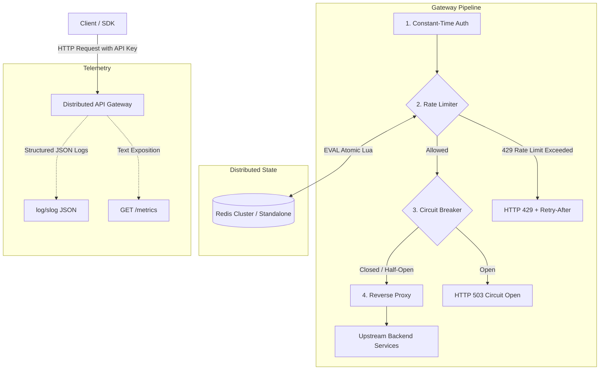

# FluxGate: Distributed Rate-Limiter & API Gateway (`v1.0.0`)

[](https://github.com/Chiru9030/distributed-rate-limiter-gateway/actions/workflows/ci.yml)
[](cmd/gateway/main.go)
[](https://golang.org/)
[](sdk-ts/package.json)
[](https://opensource.org/licenses/MIT)

A high-performance, distributed **API Gateway** written in **Go 1.24** with weighted and round-robin multi-upstream load balancing, active `/health` node monitoring, atomic Redis Lua & in-memory rate limiting (**Token Bucket**, **Sliding Window Log**, and **Leaky Bucket**), SHA-256 constant-time API key auth, protected admin tenant hot-reloading, circuit breaking, Prometheus telemetry, an embedded **jQuery Control Plane UI** (`/dashboard`), and a typed **TypeScript Client SDK**.

---

## Key Production Capabilities
- **Multi-Upstream Weighted & Round-Robin Load Balancing (`LoadBalancer`)**: Weighted distribution (`weight` per node, clamped `1..50`) and round-robin balancing across backend pools via `UPSTREAM_URLS`, with degraded fallback.
- **Active Background Health Checking**: Continuous background monitor probing `/health` on all registered nodes (`HEALTH_CHECK_INTERVAL`), isolating unhealthy upstreams cleanly.
- **Distributed Redis Lua & In-Memory Rate Limiting**: Atomic Redis Lua scripts for Token Bucket, Sliding Window Log, and Leaky Bucket shaping (`internal/ratelimit/redis.go`), seamlessly falling back to clock-injected thread-safe in-memory limiters when `REDIS_ADDR` is unset.
- **Protected Admin Control Plane & Embedded jQuery UI (`/dashboard`)**: `GET /v1/admin/status` and `POST /v1/admin/tenants` enforced via `ADMIN_API_KEY` (SHA-256 `subtle.ConstantTimeCompare`), paired with a strict CSP dashboard (`GET /dashboard`, `/dashboard/app.js`).
- **TypeScript Client SDK (`@chiru9030/gateway-sdk`)**: Bounded-concurrency `client.batch(...)` executor, `Retry-After` backoff, and `Idempotency-Key` propagation.

---

## Table of Contents
- [Architecture Overview](#architecture-overview)
- [Rate Limiting Algorithms](#rate-limiting-algorithms)
  - [1. Distributed Token Bucket (Redis Lua)](#1-distributed-token-bucket-redis-lua)
  - [2. Sliding Window Log (Redis Sorted Sets)](#2-sliding-window-log-redis-sorted-sets)
  - [3. Leaky Bucket Traffic Shaping](#3-leaky-bucket-traffic-shaping)
  - [4. Standard Rate-Limit HTTP Headers](#4-standard-rate-limit-http-headers)
- [Multi-Upstream Load Balancing & Control Plane](#multi-upstream-load-balancing--control-plane)
- [Enterprise Resilience & Security](#enterprise-resilience--security)
  - [Circuit Breaker Pattern](#circuit-breaker-pattern)
  - [Constant-Time API Key Authentication](#constant-time-api-key-authentication)
  - [Standardized Stripe-Style Error Envelopes](#standardized-stripe-style-error-envelopes)
- [Observability & Telemetry](#observability--telemetry)
- [TypeScript Client SDK (`@chiru9030/gateway-sdk`)](#typescript-client-sdk-chiru9030gateway-sdk)
- [Getting Started, Configuration & Production Deployment](#getting-started-configuration--production-deployment)
- [Test Suite & Verification](#test-suite--verification)

---

## Architecture Overview



---

## Rate Limiting Algorithms

### 1. Distributed Token Bucket (Redis Lua)
Implemented in [`internal/ratelimit/redis.go`](./internal/ratelimit/redis.go) using an atomic Lua script:
- Stores `tokens` (floating-point capacity) and `last_refreshed_ts` (epoch milliseconds) in a Redis Hash (`HMGET`/`HSET`).
- Lazily computes fractional refills on each request based on elapsed time:
  $$\Delta \text{tokens} = \min(\text{capacity}, \text{current} + \Delta t \times \text{refill\_rate})$$
- Decrements 1.0 token if available and sets a sliding TTL (`PEXPIRE`), avoiding key accumulation.
- Executes in a single atomic Redis round-trip ($O(1)$ time complexity), completely immune to read-modify-write race conditions across horizontally scaled gateway replicas.

### 2. Sliding Window Log (Redis Sorted Sets)
Provides mathematically exact rate limiting without border-burst vulnerabilities:
- Stored as a Redis Sorted Set (`ZSET`) where score is request timestamp in milliseconds.
- Atomically clears expired entries: `ZREMRANGEBYSCORE key -inf (now - window)`.
- Checks `ZCARD key < limit`: if allowed, adds current request `ZADD key now unique_id` and sets TTL.
- If rejected, calculates the exact millisecond delay until the oldest item exits the window to populate `Retry-After`.

### 3. Leaky Bucket Traffic Shaping
Implemented in both [`internal/ratelimit/redis.go`](./internal/ratelimit/redis.go) (`leakyBucketLua`) and [`internal/ratelimit/memory.go`](./internal/ratelimit/memory.go):
- Smooths bursty traffic down to a constant leak rate (`water = max(0, water - elapsed * leak_rate)`), rejecting spikes beyond capacity with exact millisecond `Retry-After` calculations.

### 4. Standard Rate-Limit HTTP Headers
Every proxied and rate-limited response includes standardized IETF/Stripe headers:
```http
HTTP/1.1 429 Too Many Requests
X-RateLimit-Limit: 100
X-RateLimit-Remaining: 0
X-RateLimit-Reset: 1700000060
Retry-After: 5
X-Request-ID: req_a1b2c3d4e5f6
X-Trace-ID: tr_9876543210ab
Content-Type: application/json

{
  "error": {
    "type": "rate_limit_error",
    "code": "rate_limit_exceeded",
    "message": "Rate limit exceeded. Please retry after the duration indicated in Retry-After.",
    "request_id": "req_a1b2c3d4e5f6",
    "trace_id": "tr_9876543210ab"
  }
}
```

---

## Multi-Upstream Load Balancing & Control Plane
- `LoadBalancer` (`internal/proxy/balancer.go`) supports `round_robin` and `weighted` traffic distribution across healthy backend pools while `StartHealthCheck` continuously probes `/health` across nodes (`HEALTH_CHECK_INTERVAL`).
- Protected Admin Control Plane (`GET /v1/admin/status`, `POST /v1/admin/tenants`) is authenticated via `ADMIN_API_KEY` and never proxied to upstream backends, paired with an embedded jQuery Control Plane UI at `/dashboard`.

---

## Enterprise Resilience & Security

### Circuit Breaker Pattern
Implemented in [`internal/proxy/circuit_breaker.go`](./internal/proxy/circuit_breaker.go):
- **Closed**: Requests pass through to upstream. Consecutive 5xx/network errors increment the failure counter.
- **Open**: When failure threshold (default: 5) is reached, circuit opens immediately, shedding load and failing fast with `503 Service Unavailable` (`circuit_open`) to prevent upstream cascading brownouts.
- **Half-Open**: After reset timeout (default: 15s), a single probe request is permitted through. If successful, circuit recovers to `Closed`; if it fails, circuit returns to `Open`.

### Constant-Time API Key Authentication
API Keys (`X-API-Key` or `Authorization: Bearer <key>`) and Admin Control Plane keys (`ADMIN_API_KEY`) are hashed with SHA-256 and compared via `crypto/subtle.ConstantTimeCompare` (`internal/auth/auth.go`, `internal/proxy/gateway.go`). Fixed 32-byte digest comparisons eliminate key-length and character-position timing side channels.

### Standardized Stripe-Style Error Envelopes
All gateway-level errors (`400`, `401`, `404`, `405`, `413`, `429`, `502`, `503`) emit consistent JSON structures containing:
- `type`: Machine-readable category (`authentication_error`, `rate_limit_error`, `invalid_request_error`, `api_connection_error`).
- `code`: Specific programmatic identifier (`invalid_api_key`, `payload_too_large`, `circuit_open`, etc.).
- `request_id` & `trace_id`: Distributed tracing identifiers propagated upstream to backend microservices.

### Connection Pooling & Max Request Guard
- Redis client maintains a pre-warmed RESP2 connection pool (`32` pooled TCP connections) with EOF stale-socket eviction and strict read-frame error disposal.
- Requests enforce a hard `2 MiB` body limit (`io.LimitReader`) before proxying so oversized payloads deterministically return `413 Payload Too Large` without tripping the shared upstream circuit breaker.

---

## Observability & Telemetry

- **Prometheus Metrics (`/metrics`)**:
  - `gateway_requests_total`: Monotonic counter of all requests handled.
  - `gateway_rate_limited_total`: Counter of 429 rejections.
  - `gateway_auth_failures_total`: Counter of 401 rejections.
  - `gateway_upstream_errors_total`: Counter of upstream 5xx/timeouts.
  - `gateway_request_duration_microseconds_sum` & `gateway_request_duration_microseconds_count`: Cumulative latency microseconds and timed request count for mean request latency monitoring.
- **Structured JSON Logging (`log/slog`)**:
  ```json
  {"time":"2026-11-12T12:00:00Z","level":"INFO","msg":"http_request","request_id":"req_123","trace_id":"tr_456","tenant":"acme_corp","method":"POST","path":"/v1/charges","status":200,"latency_ms":1.42}
  ```

---

## TypeScript Client SDK (`@chiru9030/gateway-sdk`)

A lightweight, zero-dependency client SDK located in [`sdk-ts/`](./sdk-ts/):

```typescript
import { GatewayClient, GatewayApiError } from '@chiru9030/gateway-sdk';

const client = new GatewayClient({
  baseUrl: 'https://api.yourgateway.com',
  apiKey: process.env.GATEWAY_API_KEY ?? '',
  maxRetries: 3,
});

try {
  // Automatically attaches Idempotency-Key on mutating calls
  // Transparently retries with exponential backoff on 429 (respecting Retry-After)
  const response = await client.post<{ id: string }>('/v1/transfers', {
    amount: 5000,
  });

  console.log(`Success! Request ID: ${response.requestId}`);
  console.log(`Remaining quota: ${response.rateLimit.remaining}`);
} catch (err) {
  if (err instanceof GatewayApiError) {
    console.error(`API Error [${err.code}]: ${err.message} (status: ${err.status})`);
  }
}
```

---

## Getting Started, Configuration & Production Deployment

### Environment Configuration
Copy `.env.example` and export your environment variables before starting standalone (`cmd/gateway` supports `PORT`, `LISTEN_ADDR`, `REDIS_ADDR`, `REDIS_PASSWORD`, `UPSTREAM_URLS`, `UPSTREAM_STRATEGY`, `ADMIN_API_KEY`, `GATEWAY_DEMO_API_KEY`, `ALLOWED_ORIGINS`, `HEALTH_CHECK_INTERVAL`):

```bash
cp .env.example .env
set -a && source .env && set +a
go run ./cmd/gateway
```

If `UPSTREAM_URL` and `UPSTREAM_URLS` are unset, the gateway boots a self-contained dynamic loopback upstream pool for instant local verification.

### Multi-Instance Cluster via Docker Compose
Launches Redis, weighted primary/secondary upstream echo nodes (`3:1`), and 2 Gateway replicas sharing distributed rate-limit state:

```bash
git clone https://github.com/Chiru9030/distributed-rate-limiter-gateway.git
cd distributed-rate-limiter-gateway

export ADMIN_API_KEY="your-admin-secret"
export GATEWAY_DEMO_API_KEY="your-demo-tenant-key"
docker compose up --build -d
```

Test control plane & distributed rate limiting across both instances:
```bash
# Gateway 1 & 2 health/readiness
curl http://localhost:8080/health
curl http://localhost:8080/readyz

# Gateway 1 (Port 8080) & Gateway 2 (Port 8081) sharing Redis Lua rate limit state
curl -i -H "Authorization: Bearer $GATEWAY_DEMO_API_KEY" http://localhost:8080/v1/test
curl -i -H "Authorization: Bearer $GATEWAY_DEMO_API_KEY" http://localhost:8081/v1/test

# Prometheus metrics & Control Plane UI
curl http://localhost:8080/metrics
open http://localhost:8080/dashboard
```

### Kubernetes, Render & Linux VM Production Assets
- **Kubernetes (`k8s/`):** Deploys Redis (`k8s/redis.yaml`) alongside a multi-replica non-root `Deployment` (`UID 10001`), `HorizontalPodAutoscaler` (2–8 replicas), `ClusterIP` `Service`, `ConfigMap`, CPU/memory resource limits, `/health` liveness probe, and `/readyz` readiness probe (create `rate-limiter-gateway-secrets` with `ADMIN_API_KEY` before applying: `kubectl create secret generic rate-limiter-gateway-secrets --from-literal=ADMIN_API_KEY="$(openssl rand -hex 24)" && kubectl apply -f k8s/`).
- **Render Blueprint (`render.yaml`):** Free-tier Docker web service with auto-generated `ADMIN_API_KEY` & `GATEWAY_DEMO_API_KEY`.
- **Linux VM (`deploy/vm/provision.sh`):** Compiles a static stripped binary (`CGO_ENABLED=0`) using a temporary build path under locked user `gatewayd` and configures a hardened `systemd` unit (`NoNewPrivileges=true`, `ProtectSystem=strict`).

---

## Test Suite & Verification

Run Go unit, concurrency `-race`, load balancer, admin protection, and rate-limiter tests:
```bash
go vet ./...
go test -v -race -count=1 ./...
```
Verified test functions:
- `TestGatewayAuthRoutingRateLimitAndTelemetry`
- `TestCircuitBreakerStateTransitions`
- `TestTokenBucketRefillAndBurst`
- `TestSlidingWindowLogPrecision`
- `TestConcurrentGoroutineRateLimitSafety`
- `TestLoadBalancerRoundRobin`
- `TestLeakyBucketTrafficShaping`
- `TestDynamicAdminTenantHotReload`
- `TestWeightedLoadBalancerAndAdminProtection`
- `TestGatewayV1AuditRegressions` (covers RESP2 `RedisLimiter` auth/ping/EOF retry/Lua algorithms/rate formatting, `>2 MiB` `413` without breaker poisoning, single-counted circuit breaker threshold, `/v1/admin/*` path blocking & trimmed keys, multi-origin CORS `Vary: Origin`, and `/readyz` upstream health failback)

Build and test the TypeScript SDK (`sdk-ts`):
```bash
cd sdk-ts
npm ci
npm run build
npm test
```
